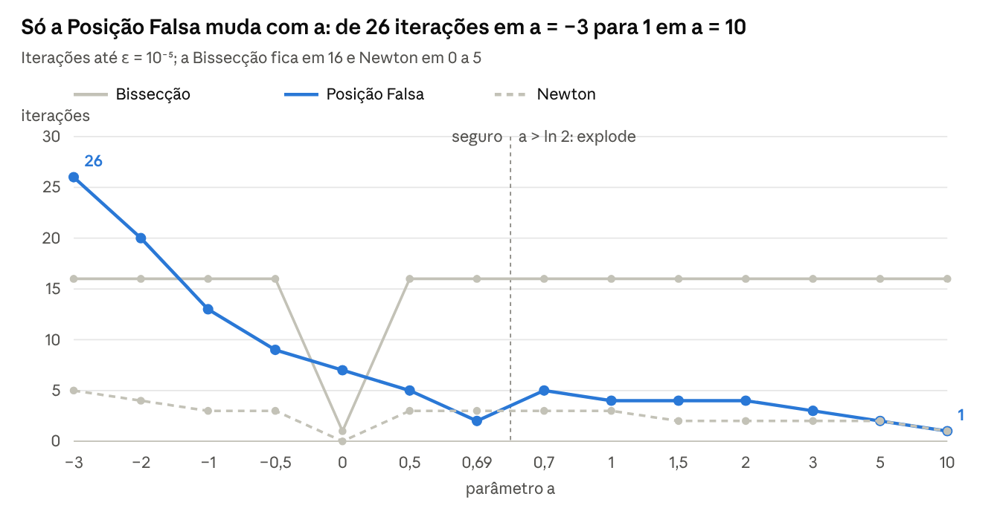

# Métodos Numéricos — Trabalho 1

## Análise matemática do Tema 01

---

## Sumário
[A função](#parte01)  
[O isolamento automático](#parte02)  
[Quadro de resultados](#parte03)  
[Efeito de $a$ em cada método](#parte04)  
[Conclusões](#parte05)  
[Perguntas prováveis e respostas](#parte06)  
[Apresentação](#parte07)

---

## A função

A raiz de $f(d) = a \cdot d - d \cdot ln(d)$ é, exatamente, $d = e^{a}$, e o foguete explode se e somente se $a > \ln 2 \approx 0{,}6931$.

**Domínio:** $d > 0$, por causa do $\ln$. Fatorando,

$$f(d) = d \cdot (a - \ln d)$$

**Raiz:** $d \cdot (a - \ln d) = 0$ dá $d = 0$ (fora do domínio) ou $\ln d = a$. A única raiz é $d = e^{a}$.

**Sinal:** $f > 0$ em $(0, e^{a})$ e $f < 0$ em $(e^{a}, \infty)$. Qualquer intervalo $[L, U]$ com $L < e^{a} < U$ tem $f(L) \cdot f(U) < 0$.

**Derivadas:**

$$f'(d) = a - 1 - \ln d, \qquad f''(d) = -\frac{1}{d}$$

**Concavidade:** $f'' < 0$ em todo o domínio, então $f$ é côncava.

**Máximo:** $f'(d) = 0$ em $d^{*} = e^{a-1} = \dfrac{e^{a}}{e}$. A função cresce em $(0, d^{*})$ e decresce depois.

**Na raiz:** $f'(e^{a}) = a - 1 - a = -1$ para todo $a$, e $f''(e^{a}) = -e^{-a}$. A raiz é simples, o que garante a convergência quadrática de Newton.

**Segurança:** o enunciado diz que o foguete explode se $d$ passar de 2 cm. Isso vale quando $e^{a} > 2$, ou seja, $a > \ln 2 \approx 0{,}693147$. O teste padrão ($a = 1$, $d \approx 2{,}71828$ cm) é um foguete que explode.

---

## O isolamento automático

A função `gerarIntervaloAutomatico` (em `funcoes.h`) isola a raiz a partir da própria solução exata $e^{a}$: ela pega os inteiros vizinhos de $e^{a}$. Como o enunciado só dá $n$, $a$ e $\varepsilon$ como entrada, é o programa que precisa achar o intervalo.

| Caso | Intervalo gerado | Exemplo |
|---|---|---|
| $a > 0$, $e^{a}$ não inteiro | $[\lfloor e^{a} \rfloor,\ \lceil e^{a} \rceil]$ | $a = 1 \to [2, 3]$, o mesmo isolamento do enunciado |
| $e^{a}$ inteiro ($a = 0$ ou $a = \ln 2$) | $[e^{a} - 0{,}5;\ e^{a} + 0{,}5]$ | $a = 0 \to [0{,}5;\ 1{,}5]$ |
| $a < 0$ ($\lfloor e^{a} \rfloor = 0$, fora do domínio) | $[e^{a}/10;\ 1]$ | $a = -1 \to [0{,}0368;\ 1]$ |

**Por que o intervalo é válido (Bolzano):** nos três casos $L < e^{a} < U$, então $f(L) > 0$ e $f(U) < 0$. Como a raiz é única, o intervalo contém exatamente uma raiz. A largura é sempre $\leq 1$.

**Onde fica o máximo $d^{*} = e^{a}/e$:** para $a \geq 0$, $d^{*}$ fica à esquerda de $L$. Então $f' < 0$ em todo o intervalo, e as hipóteses da Posição Falsa e de Newton valem. Para $a < 0$, $L = e^{a}/10 < d^{*} = e^{a}/e < e^{a}$: o máximo fica dentro do intervalo e $f'$ troca de sinal. Isso não afeta a Bissecção, mas é o que deixa a Posição Falsa lenta (seção 4).

**Conclusão:** o estudo analítico mostra que a raiz é única e vale $e^{a}$. O isolamento entre inteiros consecutivos é conferido por Bolzano. O valor exato serve para medir o erro real de cada método.

**Limite numérico:** o $\varepsilon$ do programa é absoluto. Para $a > 24{,}5$, o espaço entre dois doubles vizinhos de $e^{a}$ já passa de $10^{-5}$, e $\varepsilon = 10^{-5}$ deixa de ser atingível. Para $a > 36{,}7$ ($e^{a} > 2^{53}$), $\lfloor e^{a} \rfloor = \lceil e^{a} \rceil$ e o $\pm 0{,}5$ se perde no arredondamento. Nesse caso os métodos fazem 0 iterações e só devolvem $\exp(a)$. Fisicamente são deslocamentos absurdos, então não afetam a análise.

---

## Quadro de resultados

Fizemos alguns testes com 15 foguetes e os três métodos concordam no estado de todos os testes. Os foguetes são seguros até $a = \ln 2$ e explodem a partir de $a = 0{,}7$.

| $a$ | Isolamento | Raiz exata $e^{a}$ (cm) | Erro real Bissecção | Erro real Pos. Falsa | Erro real Newton | Estado |
|---|---|---|---|---|---|---|
| −3 | $[0{,}00498;\ 1]$ | 0,049787 | $3{,}7 \cdot 10^{-6}$ | $8{,}6 \cdot 10^{-6}$ | $4{,}9 \cdot 10^{-8}$ | Seguro |
| −2 | $[0{,}0135;\ 1]$ | 0,135335 | $6{,}2 \cdot 10^{-6}$ | $6{,}4 \cdot 10^{-6}$ | $8{,}8 \cdot 10^{-7}$ | Seguro |
| −1 | $[0{,}0368;\ 1]$ | 0,367879 | $5{,}3 \cdot 10^{-6}$ | $3{,}8 \cdot 10^{-6}$ | $2{,}3 \cdot 10^{-7}$ | Seguro |
| −0,5 | $[0{,}0607;\ 1]$ | 0,606531 | $1{,}2 \cdot 10^{-6}$ | $2{,}8 \cdot 10^{-6}$ | $7{,}2 \cdot 10^{-10}$ | Seguro |
| 0 | $[0{,}5;\ 1{,}5]$ | 1 | 0 | $4{,}9 \cdot 10^{-6}$ | 0 | Seguro |
| 0,5 | $[1;\ 2]$ | 1,648721 | $1{,}5 \cdot 10^{-6}$ | $6{,}0 \cdot 10^{-6}$ | $1{,}1 \cdot 10^{-10}$ | Seguro |
| 0,69 | $[1;\ 2]$ | 1,993716 | $5{,}5 \cdot 10^{-6}$ | $4{,}3 \cdot 10^{-6}$ | $1{,}5 \cdot 10^{-6}$ | Seguro |
| ln 2 (limite) | $[1{,}5;\ 2{,}5]$ | 2 | 0 | $7{,}6 \cdot 10^{-6}$ | 0 | Seguro |
| 0,7 | $[2;\ 3]$ | 2,013753 | $3{,}1 \cdot 10^{-6}$ | $2{,}3 \cdot 10^{-6}$ | $4{,}3 \cdot 10^{-8}$ | Explode |
| 1 | $[2;\ 3]$ | 2,718282 | $2{,}8 \cdot 10^{-6}$ | $4{,}8 \cdot 10^{-6}$ | $6{,}4 \cdot 10^{-11}$ | Explode |

Erro real $= |\text{raiz calculada} - e^{a}|$. Nenhum método passou de $\varepsilon = 10^{-5}$ em nenhum dos 15 foguetes. O chute do primeiro x de Newton é sempre feito no ponto médio do isolamento.

**Como ler o quadro que o programa imprime:** O quadro mostra o erro estimado por cada método, e nos três ele é confiável:

- **Bissecção:** informa a metade da largura final ($\approx 7{,}6 \cdot 10^{-6}$). Esse valor é um limite superior, então o erro real fica sempre abaixo dele.
- **Posição Falsa:** informa $|f(d)|$ no ponto final. Como $f'(e^{a}) = -1$, vale $|f(d)| \approx |d - e^{a}|$, e o valor coincide com o erro real.
- **Newton:** informa $|f(d)|$ ou o último passo, que aqui também coincidem com o erro real.

**Efeito de $a$ no erro relativo:** Como $\varepsilon$ é absoluto, a precisão relativa depende de $a$: erro relativo $=$ erro $/\, e^{a}$. Em $a = -3$ ($d \approx 0{,}05$ cm), um erro de $10^{-5}$ equivale a $2 \cdot 10^{-4}$ da raiz. Em $a = 10$, equivale a $5 \cdot 10^{-10}$. Ou seja, foguetes com $a$ negativo têm menos algarismos significativos corretos.

**Conferência com os quadros do Membro 5:** feita em 01/11/2026, a saída dos testes realizados pelo Max é idêntica, linha por linha, à rodada usada aqui. Na coluna "Valor a" do programa, o foguete 8 é $a = \ln 2$, de raiz $2{,}00000$.

---

## Efeito de $a$ em cada método

A Bissecção não depende de $a$, a Posição Falsa depende muito e Newton é sempre o mais rápido.

| $a$ | Isolamento | Raiz exata $e^{a}$ (cm) | Erro real Bissecção | Erro real Pos. Falsa | Erro real Newton | Estado |
|---|---|---|---|---|---|---|
| 1,5 | $[4;\ 5]$ | 4,481689 | $7{,}2 \cdot 10^{-6}$ | $4{,}1 \cdot 10^{-6}$ | $1{,}5 \cdot 10^{-10}$ | Explode |
| 2 | $[7;\ 8]$ | 7,389056 | $4{,}9 \cdot 10^{-6}$ | $9{,}1 \cdot 10^{-7}$ | $4{,}5 \cdot 10^{-8}$ | Explode |
| 3 | $[20;\ 21]$ | 20,085537 | $3{,}8 \cdot 10^{-6}$ | $9{,}1 \cdot 10^{-7}$ | $4{,}3 \cdot 10^{-7}$ | Explode |
| 5 | $[148;\ 149]$ | 148,413159 | $4{,}5 \cdot 10^{-6}$ | $1{,}6 \cdot 10^{-6}$ | $2{,}1 \cdot 10^{-12}$ | Explode |
| 10 | $[22026;\ 22027]$ | 22026,465795 | $2{,}6 \cdot 10^{-6}$ | $5{,}6 \cdot 10^{-6}$ | $2{,}7 \cdot 10^{-8}$ | Explode |

Iterações até $\varepsilon = 10^{-5}$ para cada método: a Posição Falsa cai de 26 iterações em $a = -3$ para 1 em $a = 10$; a Bissecção fica em 16; Newton fica entre 0 e 5. A linha tracejada marca $a = \ln 2$, a partir de onde o foguete explode.

### Bissecção: não depende de $a$

- O método itera até a metade da largura ficar $\leq \varepsilon$:

$$\frac{U - L}{2^{k+1}} \leq \varepsilon \implies k \geq \log_2\!\left(\frac{U - L}{\varepsilon}\right) - 1 = \log_2(10^{5}) - 1 \approx 15{,}6$$

- Como $U - L \approx 1$ para todo $a$ (para $a < 0$, a largura é $1 - e^{a}/10$), são sempre 16 iterações. As exceções são $a = 0$ e $a = \ln 2$. Nelas $e^{a}$ é inteiro, o intervalo fica centrado na raiz e o 1º ponto médio já é a raiz exata.
- **Erro:** o código devolve o ponto médio do intervalo final, então o erro real fica sempre abaixo da metade da largura final ($\approx 7{,}6 \cdot 10^{-6}$). Nos 15 casos ele ficou entre $1{,}2 \cdot 10^{-6}$ e $7{,}2 \cdot 10^{-6}$, ou foi 0 quando o método acertou a raiz exata. A posição de $e^{a}$ dentro do intervalo muda o erro, mas não o número de iterações.

### Posição Falsa: a mais sensível a $a$

- Como $f$ é côncava e $f(L) > 0 > f(U)$, a corda fica abaixo da curva. Cada ponto novo cai à esquerda da raiz e substitui $L$. **O extremo $U$ nunca se move:** em $a = -3$, $U = 1$ nas 26 iterações.
- Com um extremo fixo, a convergência é linear: o erro cai por um fator constante $C$ a cada iteração.

$$e_{k+1} \approx C \cdot e_k, \qquad C = 1 - \frac{U - e^{a}}{|f(U)|}$$

$C$ mede o quanto a curva se afasta de uma reta entre a raiz e $U$: quanto mais curva, maior $C$ e mais iterações. $C$ vale $0{,}68$ em $a = -3$, $0{,}37$ em $a = -1$, $0{,}05$ em $a = 1$ e $0{,}02$ em $a = 3$. As razões entre erros sucessivos no rastreamento do código batem com esses valores.

Para $a < 0$, $U = 1$ fica longe da raiz e o máximo de $f$ fica dentro do intervalo, então a curva é bem curva. Para $a > 0$, a curvatura no intervalo é $f'' \approx -e^{-a}$, quase nula. Ali $f$ é praticamente uma reta e a corda acerta quase de primeira.

O efeito não é monótono, porque também depende de onde $e^{a}$ cai no intervalo. Em $a = 0{,}69$, $e^{a} = 1{,}9937$ fica colado em $U = 2$ ($C = 0{,}002$) e bastam 2 iterações. Em $a = 0{,}7$, $e^{a} = 2{,}0138$ fica longe de $U = 3$ ($C = 0{,}18$) e são 5.

**Critério de parada:** o código para quando $|f(d)| \leq \varepsilon$. Como $f'(e^{a}) = -1$, vale $|f(d)| \approx |d - e^{a}|$, e esse critério controla o próprio erro real. Parar pelo tamanho do passo seria arriscado aqui: com $C$ grande, o passo fica bem menor que o erro, pois

$$\text{erro} \approx \text{passo} \cdot \frac{C}{1 - C}.$$

Em $a = -3$, uma versão anterior do código parava pelo passo e terminava com erro real de $1{,}85 \cdot 10^{-5}$, acima de $\varepsilon$.

### Newton: sempre o mais rápido

A raiz é simples, então a convergência é quadrática:

$$e_{k+1} \approx K \cdot e_k^{2}, \qquad K = \frac{|f''(e^{a})|}{2 \cdot |f'(e^{a})|} = \frac{e^{-a}}{2}$$

- $a \geq 0$: o chute $x_0$ (ponto médio) fica a no máximo $0{,}5$ da raiz e $K \leq 0{,}5$, então bastam 1 a 3 iterações. Em $a = 0$ e $a = \ln 2$ são 0 iterações, porque o chute já é a raiz exata. Em $a = 1$, o erro cai de $1{,}0 \cdot 10^{-2}$ para $1{,}9 \cdot 10^{-5}$ e depois para $6{,}4 \cdot 10^{-11}$.
- $a < 0$: $x_0 \approx 0{,}5$ fica longe de $e^{a}$ e $K$ cresce ($K = 10$ em $a = -3$). As primeiras iterações só aproximam, e o regime quadrático começa perto da raiz. Em $a = -3$, o erro passa por $1{,}0 \cdot 10^{-1}$, $2{,}2 \cdot 10^{-2}$, $2{,}8 \cdot 10^{-3}$, $7{,}0 \cdot 10^{-5}$ e $4{,}9 \cdot 10^{-8}$ (5 iterações).

**Condição de Fourier:** $f(x_0) \cdot f''(x_0) > 0$ equivale a $x_0 > e^{a}$, porque $f'' < 0$. Para $a < 0$ ela vale sempre ($x_0 \approx 0{,}5$), e a convergência é monótona. Para $a > 0$, só vale se a parte fracionária de $e^{a}$ for menor que $0{,}5$.

Em $a = 1$, por exemplo, $x_0 = 2{,}5 < e$: o 1º passo ultrapassa a raiz ($2{,}7284$) e depois converge de forma monótona. Converge mesmo assim, porque $f'$ não se anula no intervalo.

Para $a$ grande, $K \to 0$ e Newton acerta em 1 iteração ($a = 10$). A trava de $f' \approx 0$ do código nunca foi acionada nos testes.

---

## Conclusões

A raiz exata é $d = e^{a}$. O foguete é seguro se $a \leq \ln 2 \approx 0{,}693$. No teste padrão ($a = 1$), $d \approx 2{,}71828$ cm e o foguete explode.

Os três métodos concordam no estado de todos os foguetes testados.

- **Bissecção:** 16 iterações para qualquer $a$, porque só depende da largura do intervalo. É a mais robusta e a mais lenta para $a \geq 0$.
- **Posição Falsa:** é a mais sensível a $a$. Faz 13 a 26 iterações para $a \leq -1$, porque a curvatura é forte e o extremo direito fica fixo. Para $a \geq 0{,}5$ faz só 1 a 5, porque a curva é quase reta no intervalo.
- **Newton:** é o mais rápido em todos os casos (0 a 5 iterações). A convergência é quadrática porque $f'(e^{a}) = -1 \neq 0$. Fica um pouco mais lento para $a < 0$, onde a constante $e^{-a}/2$ cresce. Também é o mais preciso: o erro real fica entre $10^{-12}$ e $10^{-6}$, enquanto o dos outros dois fica entre $9 \cdot 10^{-7}$ e $9 \cdot 10^{-6}$.

**Ranking:** para $a \geq -1$, Newton $<$ Posição Falsa $\leq$ Bissecção em iterações. Para $a \leq -2$, a Posição Falsa passa a ser a pior das três. Há duas exceções, $a = 0$ e $a = \ln 2$: nelas $e^{a}$ é o centro do intervalo, e a Bissecção acerta a raiz exata na 1ª iteração.

---

## Perguntas prováveis e respostas

1. **"Se a raiz é $e^{a}$, para que método numérico?"** O valor exato permite medir o erro real de cada método, e não só o erro estimado. A análise do efeito de $a$ só é possível por isso.

2. **"Como vocês isolaram a raiz?"** Pelo estudo analítico, $f > 0$ antes de $e^{a}$ e $f < 0$ depois. O intervalo entre inteiros consecutivos é conferido por Bolzano, com $f(L) \cdot f(U) < 0$. Para $a = 1$ isso dá exatamente o $(2, 3)$ do enunciado.

3. **"Por que a Bissecção sempre faz 16 iterações?"** Porque $\log_2(1/10^{-5}) - 1 \approx 15{,}6$, e a largura é $\approx 1$ para qualquer $a$.

4. **"Por que a Posição Falsa demora para $a$ negativo?"** Como $f$ é côncava, o extremo direito fica fixo e a convergência vira linear com taxa $C$. Para $a < 0$, o máximo de $f$ fica dentro do intervalo e $C$ chega a $0{,}68$.

5. **"Por que Newton converge tão rápido?"** Porque $f'(e^{a}) = -1 \neq 0$, ou seja, a raiz é simples e a convergência é quadrática: o número de casas corretas dobra a cada passo.

6. **"Newton pode falhar aqui?"** Só se o chute caísse perto de $d^{*} = e^{a-1}$, onde $f' = 0$. Com o chute no ponto médio isso não acontece para nenhum $a$: $d^{*}$ fica fora do intervalo ($a \geq 0$) ou à esquerda do chute ($a < 0$).

7. **"E se $a = \ln 2$?"** Então $d = 2$ exatamente, que não passa de 2 cm: o foguete é seguro. Mas para $|a - \ln 2| < \varepsilon/2 \approx 5 \cdot 10^{-6}$, a raiz calculada pode cair do outro lado de 2, e com essa precisão a classificação fica inconclusiva.

8. **"Algum método errou mais que $\varepsilon$?"** Não. Nos 15 foguetes, o erro real ficou abaixo de $10^{-5}$ nos três métodos. A Bissecção devolve o ponto médio do intervalo final. A Posição Falsa e Newton param por $|f(d)| \leq \varepsilon$, que aqui equivale ao erro real porque $f'(e^{a}) = -1$.

---

## Apresentação

